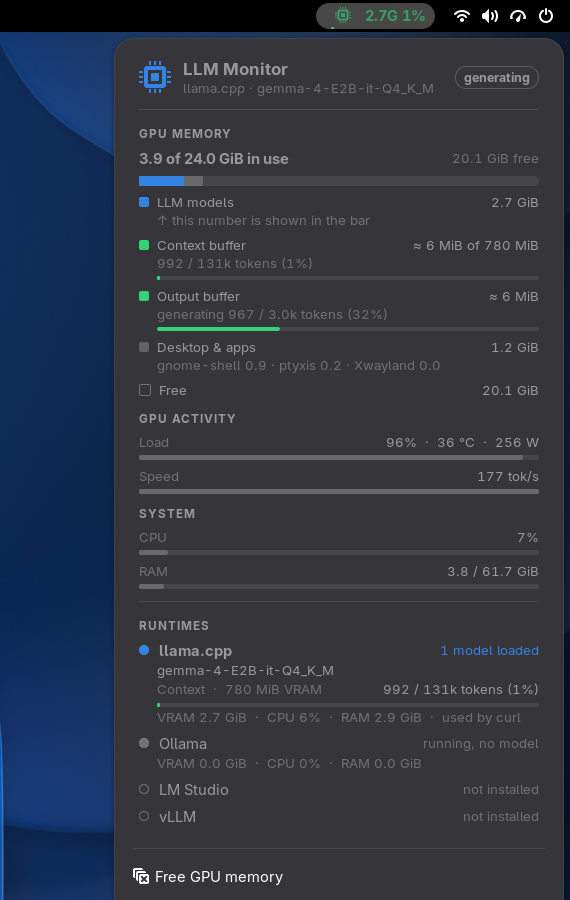

# LLM Monitor for GNOME

**See at a glance when a local LLM is using your GPU, how much it holds, how full its context is, and who is using it.**

LLM Monitor is a GNOME Shell extension (GNOME 51) for people who run local models with **llama.cpp**, **Ollama**, **LM Studio** or **vLLM**. It is the GNOME port of the Omarchy bar widget [LLM Monitor](https://github.com/uBruckhaus/omarchy-llm-usage) and uses the same collector.



- **Top bar indicator:** a chip icon. Dim while no model is loaded. While a model is resident it shows the GPU memory held by local models and how full the model's context is (e.g. `18.0G 33%`), with a thin fill line underneath. It pulses while the GPU is generating. A `!` marks model memory that no longer fits in VRAM and was moved to system RAM.
- **Context colours:** the chip, its fill line and the panel's buffer bars turn **green** (below 50 %), **yellow** (50 %), **orange** (75 %) and **red** (90 %) as the context fills up. Without a context figure the chip uses your GNOME accent colour.
- **Detail panel (left click):**
  - **GPU memory** as one stacked bar with a legend: *LLM models* (the number in the bar), *Desktop & apps* (with the programs behind it, e.g. gnome-shell, browser) and *Free*.
  - **Context buffer:** tokens in the context window (e.g. `33k / 98k tokens`) and the share of the reserved KV-cache memory they fill (`≈ 624 MiB of 1.8 GiB`).
  - **Output buffer:** tokens of the reply being generated against its limit (`max_tokens` or the model's `n-predict`). The last reply stays visible after it ends.
  - **GPU activity:** load, temperature and power, plus the **generation speed**: live tokens per second while it writes, and min / avg / max over the replies since the monitor started watching (llama.cpp, vLLM).
  - **System:** CPU and RAM.
  - **Runtimes:** llama.cpp, Ollama, LM Studio and vLLM, each with state (not installed / stopped / running / model loaded / model sleeping), model name, context fill, VRAM, CPU, RAM and the programs currently connected (e.g. pi).
  - **Free GPU memory** and **Open btop**.
- **Right click:** opens btop (or brings an open btop window to the front).

English only.

## Install

Requires GNOME Shell 51 and `python3` (standard library only). btop is optional.

```sh
tools/build.sh
gnome-extensions install --force dist/llm-monitor@ubruckhaus.github.io.shell-extension.zip
```

Log out and back in, then `gnome-extensions enable llm-monitor@ubruckhaus.github.io`.

GPU memory, load, temperature and power are read from the amdgpu sysfs and DRM `fdinfo` interfaces (AMD GPUs). On other GPUs the runtime and system information still works; GPU values may be missing.

## How it works

A collector (`scripts/llm-monitor.py`) runs while the extension is enabled and streams one snapshot every two seconds (about 1–2 % of one CPU core, ~25 MiB RAM).

- **Read-only by default.** It reads `/proc`, sysfs and the runtimes' local status endpoints on `127.0.0.1` (llama.cpp 8080, Ollama 11434, LM Studio 1234, vLLM 8000 or its `--port`) **only while that runtime is already running**. It never starts, stops or reconfigures a runtime by itself and sends nothing to the network.
- **Runtimes are told apart by systemd unit and executable path**, because Ollama and LM Studio both ship an engine named `llama-server`.
- **One-shot llama.cpp tools** (`llama-tts`, `llama-cli`, `llama-mtmd-cli`, ...) count as llama.cpp while they run, e.g. Simple Reader's Qwen voices. They have no HTTP API, so they show the model, VRAM, CPU, RAM and the program that started them, but no context or output buffers.
- **GPU memory per runtime** comes from DRM `fdinfo` (`drm-resident-vram`), so only memory that is really in VRAM is counted; requested-but-evicted memory is reported separately.
- **Context and output buffers.** llama.cpp: tokens from `/slots`; the KV-cache size is projected once per model load with `llama-fit-params` from the same llama.cpp build (CPU only, nothing is loaded onto the GPU). vLLM: KV-cache fill from `/metrics` (`kv_cache_usage_perc`, pool size from `cache_config_info`); vLLM does not report a per-reply output limit, so it has no output-buffer row. Ollama and LM Studio report only the configured context size.
- **Installed or not** is checked about once a minute (command on `PATH`, systemd unit, LM Studio's `~/.lmstudio`, or the `vllm` Python package), so a runtime you never installed shows *not installed* instead of *stopped*.

### Free GPU memory (the only action that changes anything)

Only when you click **Free GPU memory**, `scripts/free-gpu.sh` runs:

- `systemctl --user stop llama-server.service ollama.service vllm.service` (user units only, no root),
- `lms unload --all` if the LM Studio daemon is running (its daemon keeps running).

This stops those local AI services for every program using them at that moment.

## Differences from the Omarchy widget

- GNOME Shell extension instead of a Quickshell bar widget; no language setting and no plugin information page.
- btop opens through `xdg-terminal-exec` (else Ptyxis, Console or GNOME Terminal).
- llama.cpp context size: the model's `--ctx-size` is used as the context total. With llama.cpp's unified KV cache (the default) every slot reports the whole cache, so adding up the slots counted it several times.

## Development

```sh
python3 llm-monitor@ubruckhaus.github.io/scripts/llm-monitor.py --once | python3 -m json.tool
python3 -m unittest discover -s tests
tools/headless-test.sh panel     # isolated headless GNOME Shell; screenshots in dist/screenshots/
```

Licensed under [MIT](LICENSE).
